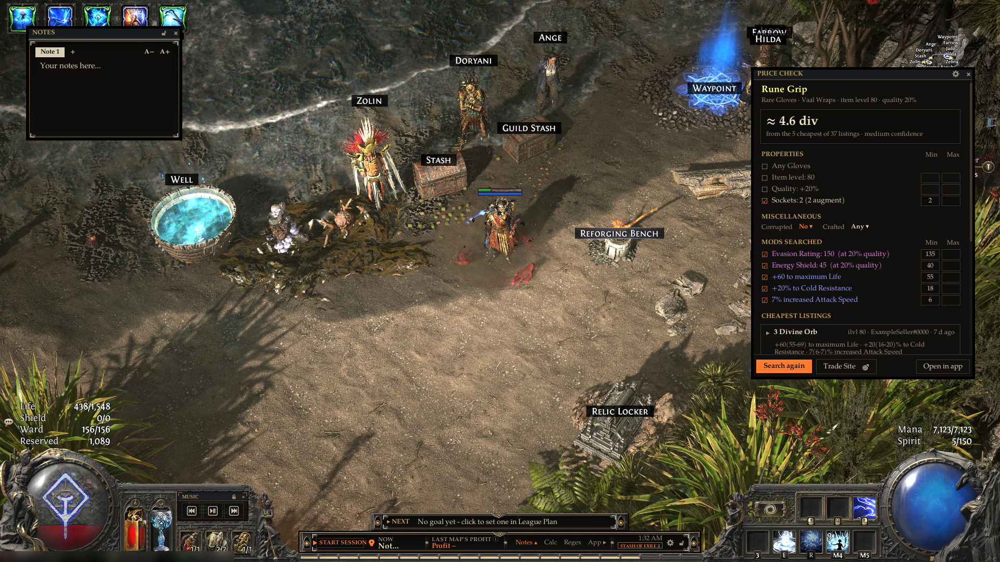
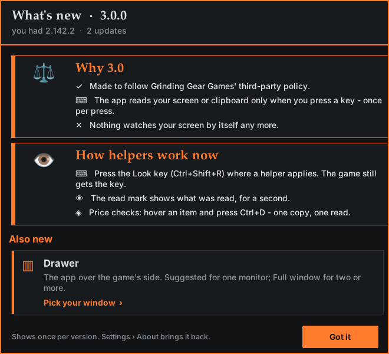

# StashOfExile2

*One tool to rule them all.*

> **GGG ToS safety check - read first.** One key press = one action · nothing plays the game for you · never touches the game's memory, code or traffic · reads Client.txt, the trade site and poe.ninja, and your clipboard or screen only once per key press. Every change must pass [TOS.md](TOS.md).

A free, open-source Windows companion for **Path of Exile 2**: price checks, bulk pricing, exchange rates, helpers over the game and league planning. Written by Claude (an AI by Anthropic), directed and tested by a human player.

| The Drawer (one monitor) | The Overlay over the game |
|---|---|
|  |  |

*Screenshots: sample data and made-up listings.*

## New in 3.0

- **Why 3.0** - to follow Grinding Gear Games' third-party policy: the app reads your screen or clipboard only when you press a key, once per press. Nothing watches your screen by itself.
- **How helpers work now** - press your **Read Key** (**Ctrl+Shift+R**) where a helper applies. The read mark (👁) shows what was read. A price check reads the clipboard on its key (**Ctrl+D**).
- **Drawer** - the app over the game's side: suggested for one monitor. **Full window** is suggested for two or more.
- **Trial of the Sekhemas** (BETA), **Back from a map** (Map profit + Top Up Reminders in one card), **Campaign Bar**, **Broaden Search** on price checks.
- Gone, because they watched the screen by themselves: the Delirium helper, the Temple Helper's Vaal Beacon read, Map Content reads. The Toolkit row is gone too (Go to anything, Ctrl+K, finds every page).

A small **NEW** chip marks what's new on its row and on its page's icon, until you open or use it.

## Third-party policy

GGG's rule for tools: *"Reading from the screen or clipboard may only be performed once per manual key press."* The app follows it at its strictest - only a key you press for the read, never a timer, a click, a file change or the app starting.

- **One read per key press.** Holding a key reads once. Each read shows the read mark (👁) for a second and writes a line in the app's log.
- **Your screen: only on the Read Key.** **Ctrl+Shift+R** as the app comes (Settings › Keybinds). One picture of the game window; every helper that applies where you are reads its part, then it's dropped. Clear the key and nothing reads the screen.
- **Your clipboard: only on a copy key.** The price check key (Ctrl+D), Ctrl+Alt+C for Bulk Pricing, the Top Up key: one read, 0.2 s after the press. A chat command key reads it once, to put your text back. Ctrl+V in one of the app's boxes. Nothing watches the clipboard.
- **The game's log (Client.txt)** is followed all the time: where you are, Breach warnings, rituals started, whispers.
- **Never** the game's memory, files or network traffic. The game client is never changed.
- **Never a macro.** After your key press the app does at most one thing in the game: the game's own item copy, or one chat command. The mouse is never moved or clicked for you.
- The trade site is searched only for what you started, well inside its limits, with a User-Agent that says who is asking. Rates come from poe.ninja.
- The full list of every read and its trigger: [TOS.md](TOS.md).
- **Older versions are gone.** Every release before 3.0.0 was removed from GitHub, because those versions read the screen by themselves. Please don't use them with the game. Details: [docs/REMOVED_VERSIONS.md](docs/REMOVED_VERSIONS.md).

This product isn't affiliated with or endorsed by Grinding Gear Games in any way.

## What it does

**Trade**
- **Price Checks** - hover an item, press **Ctrl+D**: price, how sure, and how it was worked out. Too few listings for a base? **Broaden Search** widens it, one step a click.
- **Bulk Pricing** - **Ctrl+Alt+C** on many items (tablets, waystones, jewels): priced as a list.
- **Favorites**, **Rate Mods** (your ratings tune your price checks), **Exchange Rates** (poe.ninja, a converter, a flip check), **Market Insights**.

**Stash**
- **Wealth** - what your stash is worth: Scan stash reads one tab per Read Key press.
- **Regex** - stash search strings for tablets, waystones, relics, jewels and gear.
- **Craft Helper** (BETA) - each mod of a tablet or jewel rated S to F, and a next step.

**League**
- **League Plan**, **Map Profit** (BETA), **Farming Strategies** (BETA), **Map Library**, **Leaderboards** (opt-in).

**Tools**
- **Game Search** - every skill, item, mod and keyword, from the game's own data, on your PC.

**Overlay** (over the game, Bar or Panel layout)
- **Session timer**, Notes, Calc, Regex and Rates menus, the **Price check overlay**.
- Helpers - press your **Read Key** where one applies: **Ritual** (counter, Favours prices, Ritual Identifier), **Expedition** (remnant rewards, Island rumors), **Desecration Helper**, **Temple Helper** (BETA, Vaal Lens), **Trial of the Sekhemas** (BETA), **Back from a map** (Map profit, Top Up Reminders).
- From the game's log: **Breach**, **Campaign Helper** and the **Campaign Bar**, **Trade whispers**, **Break reminders**. Plus **Music Controls**.

## Window: Drawer or Full window

- **Drawer** - suggested for one monitor. The app over the game's side; **Ctrl+Shift+Space** (the Drawer key) shows it and puts it away.
- **Full window** - suggested for two or more monitors. A normal window, where you left it.
- Switch any time: Settings › General › Window.

## Install and update

Two Windows downloads on every [release](https://github.com/StashOfExile/StashOfExile2/releases/latest) - pick one:

- **Installer** - `Setup-StashOfExile2-<version>.exe`. Puts it in your Start menu and Windows search, and in Settings › Apps to uninstall. Installs for you only, so no admin prompt.
- **Portable** - `StashOfExile2.exe`. Run it from any folder.

Both update themselves, and both keep your settings in `%APPDATA%\StashOfExile2` - uninstalling never deletes them.

The project moved to [github.com/StashOfExile/StashOfExile2](https://github.com/StashOfExile/StashOfExile2). If your 2.x app doesn't offer 3.0 by itself, download it once from Releases - it updates itself from then on, and your settings are kept.

Each release lists the SHA-256 of every download and a VirusTotal scan of the exe: open the [latest release](https://github.com/StashOfExile/StashOfExile2/releases/latest), then the VirusTotal link under **Check your download**.

From source (Python 3.12): `py -m pip install requests pystray pillow mss numpy opencv-python-headless` then `py stashofexile2.py`.

### Linux

Every release has a Linux download on the same page: `StashOfExile2-<version>-linux.tar.gz` (and its checksum, `SHA256SUMS-linux.txt`). Same code and same version as the Windows app, built at the same time.

- Tested on Arch + Hyprland. X11 desktops and other Wayland compositors work too, with limits.
- `tar xzf StashOfExile2-*-linux.tar.gz`, then `./StashOfExile2 --check-linux`: it lists what works on your setup, each with its fix.
- The same third-party rules hold: the screen and clipboard are read only once per key press.
- It updates itself from the same releases. Packages, window rules and known issues: [linux/README.md](linux/README.md).

## Privacy

- The usage count (on until you switch it off, Settings › Privacy & community): a random id made on your PC, every 10 minutes, so we know how many people use the app. Not your account, name or PC.
- Nothing else leaves your PC unless you turn on Community data sharing - and then only anonymous data, never names or wealth.
- Error reports: off until you say yes. Only where in the code an error happened and its type - never messages, names, items or files.
- Logs (`app_log.txt`, `crash_report.txt`) stay on your PC and leave out your names and folders. You see every word before a bug report is sent.
- Settings › Privacy & community › Leave and delete my data removes everything of yours from the community board.

## Community

Questions and bug reports: [Discord](https://discord.gg/8dwn9kaGNr). Plans: [ROADMAP.md](ROADMAP.md).

## Credits

Thank you!

- **[RePoE](https://github.com/repoe-fork/repoe-fork)** (repoe-fork): the game data behind the mod lists, Regex, Game Search and tiers, exported from Path of Exile 2's own files.
- **[poe.ninja](https://github.com/rasmuskl)** (rasmuskl): the economy data behind Exchange Rates, the rates window over the game, the Remnant prices and currency values.
- **[Exiled Exchange 2](https://github.com/Kvan7/Exiled-Exchange-2)** (Kvan7, MIT): general ideas, and the base types, mod wordings, trade-site stat ids and pseudo-total rules in `gamedata.json`, from its data files under its license; and the ideas (2.113.0) of counting each seller once and keeping a mod's Min within its tier, written our own way.
- **[Sidekick](https://github.com/Sidekick-Poe/Sidekick)**: general ideas. None of its code is used.
- **[hypr-exiled](https://github.com/gfsd3v/hypr-exiled)** (gfsd3v): the idea for the Trade Whisper Watcher, built from scratch here; none of its code is used.
- **[Path of Building PoE2](https://github.com/PathOfBuildingCommunity/PathOfBuilding-PoE2)**: the anoint recipes.
- **[poe2pricer](https://github.com/saxe78/poe2pricer)** (saxe78): the idea for Favours prices (finding the Ritual window by a piece of its own art, its rewards by their pictures). Written from scratch here; none of its code is used.
- **gruvbox** by Pavel Pertsev (morhetz), MIT: the colors of the Gruvbox Dark and Gruvbox Light themes ([github](https://github.com/morhetz/gruvbox)).
- **Catppuccin** by the Catppuccin team, MIT: the colors of the Catppuccin Mocha and Catppuccin Latte themes ([github](https://github.com/catppuccin/catppuccin)).
- **Nord** by Sven Greb (Arctic Ice Studio), MIT: the colors of the Nord theme ([github](https://github.com/nordtheme/nord)).
- **Dracula** by Zeno Rocha and the Dracula Theme team, MIT: the colors of the Dracula theme ([github](https://github.com/dracula/dracula-theme)).
- **Tokyo Night** by Enkia, MIT: the colors of the Tokyo Night theme ([github](https://github.com/enkia/tokyo-night-vscode-theme)).
- **Rosé Pine** by the Rosé Pine team, MIT: the colors of the Rosé Pine and Rosé Pine Dawn themes ([github](https://github.com/rose-pine/rose-pine-theme)).
- **Everforest** by sainnhe, MIT: the colors of the Everforest Dark theme ([github](https://github.com/sainnhe/everforest)).
- **Kanagawa** by Tommaso Laurenzi (rebelot), MIT: the colors of the Kanagawa theme ([github](https://github.com/rebelot/kanagawa.nvim)).
- **Solarized** by Ethan Schoonover, MIT: the colors of the Solarized Dark and Solarized Light themes ([github](https://github.com/altercation/solarized)).
- **NeverSink and Ryonnen** (reddit): the game's hidden setting that applies your item filter to the Ritual window (`apply_item_filter_to_ritual`), which Filter in the Ritual window walks you through ([NeverSink's video](https://www.youtube.com/watch?v=6hiQtcQhB3k)).
- **[PoE Ancients Price Helper](https://github.com/pedro-quiterio/PoeAncientsPriceHelper)** (Pedro Quitério): the idea for the Expedition Remnant Price Checker. None of its code is used.
- **[Path of Exile 2 Wiki](https://www.poe2wiki.net/wiki/Guide:Acts_quick_guide)** (poe2wiki.net editors): the Campaign Helper's Rush (carry) route follows the order and essentials of its Guide:Acts quick guide, rewritten here from the carrier's side.
- **Fonts of the ornate overlay styles** (SIL Open Font License 1.1, licenses in `soe2/fonts`): **[Cinzel](https://github.com/NDISCOVER/Cinzel)** (Natanael Gama), **[EB Garamond](https://github.com/octaviopardo/EBGaramond12)** (Georg Duffner, Octavio Pardo), **[Cormorant](https://github.com/CatharsisFonts/Cormorant)** (Christian Thalmann) **[Marcellus and Marcellus SC](https://github.com/google/fonts/tree/main/ofl/marcellussc)** (Brian J. Bonislawsky, Astigmatic), **[Metamorphous](https://github.com/google/fonts/tree/main/ofl/metamorphous)** (Sorkin Type) and **[IM FELL English SC](https://github.com/google/fonts/tree/main/ofl/imfellenglishsc)** (Igino Marini). Cinzel, EB Garamond and Cormorant were converted to TTF from [Fontsource](https://github.com/fontsource/fontsource)'s Latin files.

## License

The code is free software under the **GNU Affero General Public License v3.0** ([LICENSE](LICENSE)): you can use it, change it and share it. Anything made from it has to stay under the same license, with its source - and that includes a changed version people use over a network (a website or an online service), not only one you hand out. Versions up to 2.129.4 were released under the GNU GPL v3.0.

Game data in `regexdata.json`, `searchdata.json`, `tabs.txt`, `jewels.txt` and `tierdata.json` comes from [RePoE](https://github.com/repoe-fork/repoe-fork); `gamedata.json` (base types, mod wordings, trade-site stat ids, pseudo-total rules) is built from [Exiled Exchange 2](https://github.com/Kvan7/Exiled-Exchange-2)'s data files (MIT) (anoint recipes in `anointdata.json`: [Path of Building PoE2](https://github.com/PathOfBuildingCommunity/PathOfBuilding-PoE2)) and belongs to Grinding Gear Games; it isn't covered by this license. Other sources and their licenses are in [THIRD_PARTY_NOTICES.txt](THIRD_PARTY_NOTICES.txt).

This product isn't affiliated with or endorsed by Grinding Gear Games in any way. Path of Exile 2 is a trademark of Grinding Gear Games.
